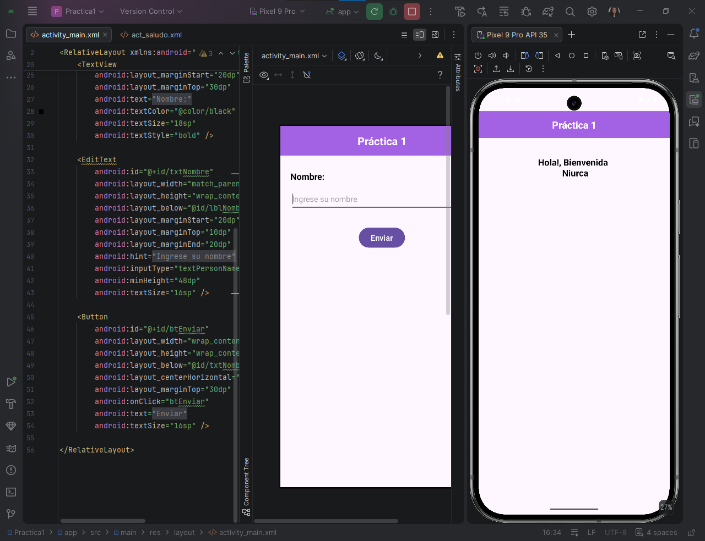

# Práctica 1 - UI ITAB

Esta es una aplicación de Android que implementa el paso de parámetros entre actividades (`MainActivity` y `actSaludo`) utilizando un formulario básico en vistas XML, `RelativeLayout`, `Intents` y `Bundles`.

## Captura de Pantalla de la Práctica 1

## Características

La interfaz de usuario ha sido construida utilizando componentes de vistas XML tradicionales e incluye las siguientes pantallas y elementos:

- **Barra de Título Superior**: Encabezado personalizado con el texto centrado "Práctica 1".
- **Pantalla Principal (MainActivity)**:
  - **Campo Nombre**: Campo de entrada (`EditText` con ID `txtNombre`) para que el usuario ingrese su nombre.
  - **Botón Enviar**: Botón de acción (`Button` con ID `btEnviar`) que dispara el método `btEnviar` al hacer clic.
- **Segunda Pantalla (actSaludo)**:
  - **Recepción de Datos**: Extrae la información enviada a través de un objeto `Bundle`.
  - **Mensaje de Bienvenida**: Etiqueta de texto (`TextView` con ID `txtSaludo`) que muestra el mensaje personalizado `"Hola!, Bienvenida \n " + bundle.getString("NOMBRE")`.

## Detalles Técnicos

- **Diseño de Interfaz**: Construido en XML (`activity_main.xml` y `act_saludo.xml`).
- **Layout Principal**: `RelativeLayout` para organizar los elementos de manera relativa en la pantalla.
- **Paso de Parámetros**:
  - Uso de un `Intent` explícito para transitar entre `MainActivity` y `actSaludo`.
  - Creación de un `Bundle` para almacenar el nombre con la clave `"NOMBRE"` y adjuntarlo mediante `intent.putExtras(bundle)`.
  - Recuperación de los datos en `actSaludo` usando `getIntent().getExtras()` y `bundle.getString("NOMBRE")`.
- **Recursos (Resources)**: Textos y colores organizados centralizadamente en `strings.xml` y `colors.xml`.
- **Manifest**: Declaración y registro correspondiente de las dos actividades (`MainActivity` y `actSaludo`) en `AndroidManifest.xml`.
